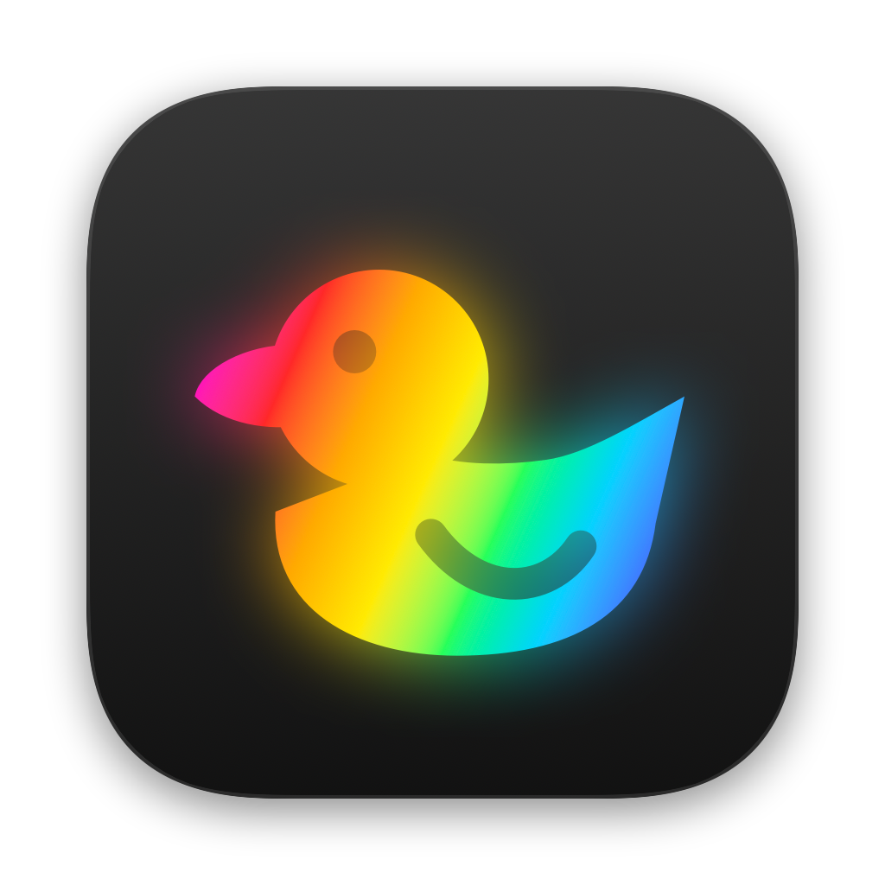
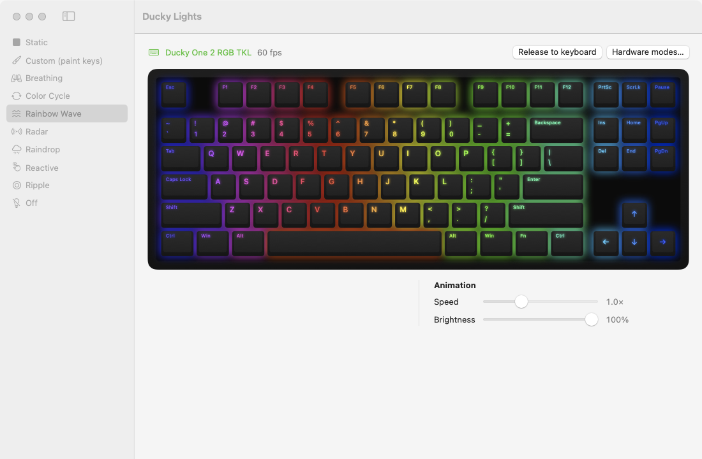
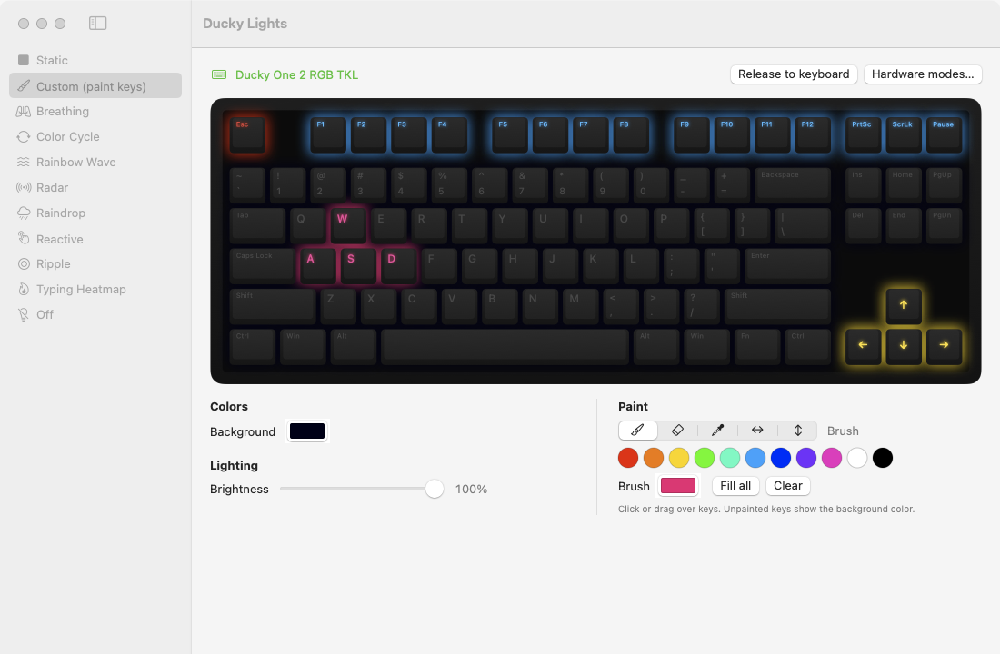
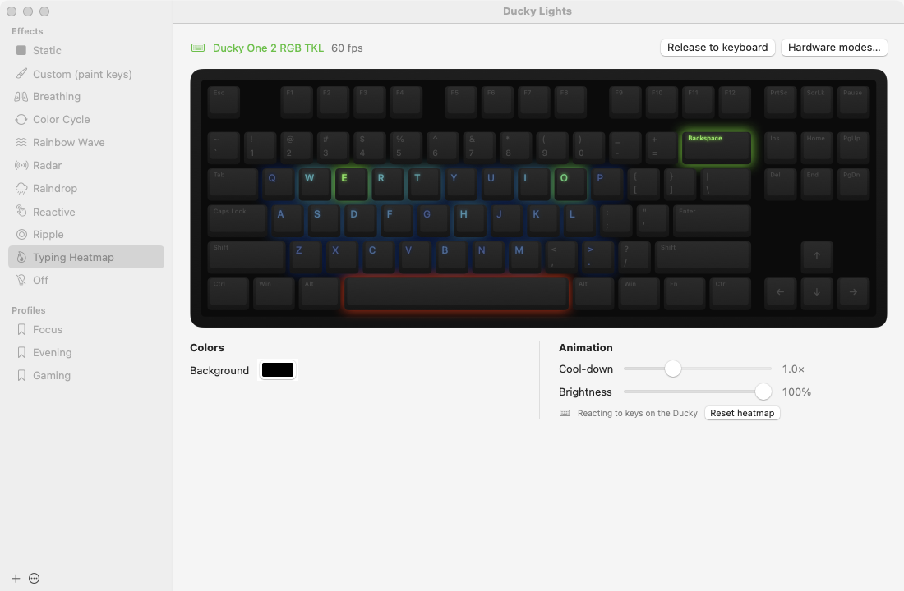
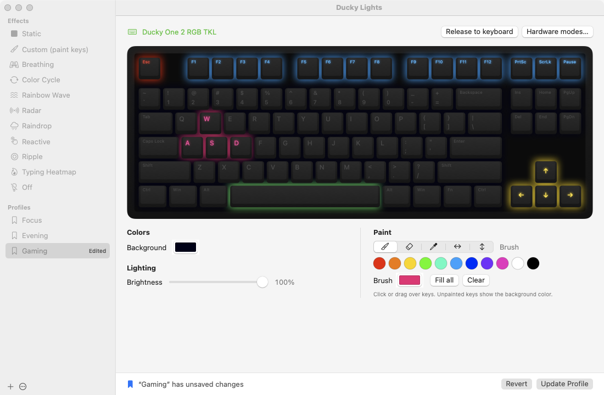

# Ducky Lights



A native macOS app for the per-key RGB lighting of the **Ducky One 2 RGB TKL**. Ducky ships no macOS software, so before this the only option was the Fn shortcuts on the board itself.

Pick an effect, tune its color, speed and brightness, or paint keys one by one. A live preview shows exactly what the keyboard shows. A duck in the menu bar lets you switch effects without opening the window.









## Features

- **Effects:** Static, Custom (paint keys), Breathing, Color Cycle, Rainbow Wave, Radar, Raindrop, Off. Each effect shows only the controls it uses.
- **Effects that react to typing:** Reactive (pressed keys flash and fade), Ripple (rings spread from each key), Typing Heatmap (the keys you use most glow hot, then cool down). Only keys on the Ducky count, not the laptop keyboard.
- **Painting** (Custom effect): brush, eraser, eyedropper, fill row, fill column. Click or drag over keys. Hovering shows which keys a click will change.
- **Profiles:** save a look (effect, colors, painted keys) under a name, and switch between looks from the sidebar or the menu bar duck. Tweak an active profile and a bar at the bottom offers **Revert** or **Update Profile**. Right-click to rename, export or delete. Import and export are in the sidebar's ⋯ menu.
- **Live preview** drawn like the real board: shine-through legends, LED light bleeding between the keys. ANSI or ISO layout (Settings).
- **Menu bar duck:** open the window, switch effects or profiles, hand control back to the keyboard, quit. Closing the window keeps the app running there.
- **Plays nice with the keyboard:** it hands lighting back to the firmware on quit, Ctrl-C/kill, sleep and screen lock, and takes it back on wake and unlock. Unplug and replug the keyboard and it carries on by itself.
- **Launch at login**, with an option to start quietly in the menu bar.
- Smooth animation: rendered at 60 fps. The USB link tops out around 95 fps.

## Requirements

- macOS 15 or later.
- A Ducky One 2 RGB TKL (USB `04D9:0356`). Check with `bash scripts/probe-usb.sh`. Single-color models can't do per-key colors. The full-size One 2 RGB (`0x0348`) uses the same protocol but hasn't been tried.
- Swift 6 (Xcode or the Command Line Tools) to build. Running the tests needs Xcode.

**Permissions.** Lighting needs none. The three typing effects need **Input Monitoring** (System Settings › Privacy & Security). The app asks the first time you pick one, and only listens while one of them is selected. It reads which key went down on the Ducky and nothing else. Typing works as normal.

## Install

```bash
git clone https://github.com/glebovsky/ducky-lights.git
cd ducky-lights
scripts/build-app.sh --install    # builds "Ducky Lights.app", copies it to /Applications, opens it
```

Run the same command again to update. It quits the running copy first, which hands the keyboard back.

**Optional, once:** `scripts/make-signing-cert.sh` creates a local signing certificate. Builds signed with it keep the Input Monitoring permission. Ad-hoc builds lose it every time you rebuild. macOS asks for your password to trust the certificate. On the next build it asks whether `codesign` may use the key: pick **Always Allow**.

## Using it

- **Settings (⌘,):** keyboard layout (ANSI/ISO), release while the screen is locked (on by default), release while the app is in the background (off), launch at login, open the window at launch.
- **Profiles** are saved in `~/Library/Application Support/Ducky Lights/profiles.json`. Exported files use the same format and are meant to be readable and editable:

  ```json
  { "format": "ducky-lights-profiles", "version": 1,
    "profiles": [ { "name": "Gaming", "effect": "Custom (paint keys)", "background": "000019",
                    "brightness": 1, "paint": { "W": "ff0080", "A": "ff0080", "Esc": "ff0000" } } ] }
  ```

  Importing always adds copies (it never overwrites), and anything unrecognized is skipped and listed. If `profiles.json` can't be read, it's kept aside as `profiles.unreadable-….json` rather than overwritten.
- **Release to keyboard** (window or duck menu) gives lighting back to the keyboard's own modes. While the app is in control, the keyboard's Fn lighting shortcuts (Fn+F10 and friends) don't respond. That's how the keyboard behaves, not a bug. **Hardware modes…** lists those shortcuts.
- **Input Monitoring shows "on" but the app says it's off:** that entry belongs to an older build with a different signature. Remove it with − in Privacy & Security (or run `tccutil reset ListenEvent com.glebovsky.DuckyLights`), then allow again.
- If the app ever crashes hard and leaves the board stuck, run `swift run duckyctl release`.

## How it works

The keyboard has a "direct mode": the Mac streams full frames of per-key colors (10 USB HID packets each) and the keyboard shows them. The app renders every effect itself and sends a frame whenever something changes, or 60 times a second for animations. The keyboard's built-in modes can't be selected from the Mac yet, because that part of the protocol hasn't been reverse-engineered (ROADMAP M5).

Byte-level details: [`docs/PROTOCOL.md`](docs/PROTOCOL.md). What was verified on hardware, and how: [`docs/RESEARCH.md`](docs/RESEARCH.md). Plan: [`docs/ROADMAP.md`](docs/ROADMAP.md).

## Development

```bash
swift build
DEVELOPER_DIR=/Applications/Xcode.app/Contents/Developer swift test   # needs Xcode for XCTest
swift run DuckyLights                     # run the app without installing
swift run duckyctl list                   # HID collections with the Ducky vendor ID
swift run duckyctl solid ff0080           # whole board one color
swift run duckyctl key Esc 00ff00         # one key
swift run duckyctl effect "Rainbow Wave" 10
swift run duckyctl bench 0 5              # timing stats: packet gap (ms), seconds
swift run duckyctl release                # back to the keyboard's own lighting
```

| Path | What |
|---|---|
| `Sources/DuckyKit/` | Library: packet encoder, key layout, effects, IOKit HID transport. No UI. |
| `Sources/DuckyLights/` | The SwiftUI app. |
| `Sources/duckyctl/` | CLI for hardware bring-up and debugging. |
| `tools/ducky.py` | Python reference implementation (hidapi) that the Swift encoder is tested against. |
| `scripts/build-app.sh` | Builds and installs the `.app`. |
| `scripts/make-icon.sh` | Regenerates the app icon. |
| `scripts/make-signing-cert.sh` | One-time local signing identity, so permissions survive rebuilds. |

Regenerate the README screenshots (offscreen, doesn't touch the keyboard):

```bash
swift build --product DuckyLights && .build/debug/DuckyLights --screenshots docs/images
```

## Status

M0 (hardware bring-up), M1 (usable app), M2 (real macOS app), M3 (effects that react to typing) and M4's named profiles are done. More effects and a URL scheme are parked. M5 (selecting the keyboard's own modes) is research. See [`docs/ROADMAP.md`](docs/ROADMAP.md).

## Credits

The protocol knowledge comes from [OpenRGB](https://gitlab.com/CalcProgrammer1/OpenRGB) (Ducky controller by Adam Honse), [duckylights](https://github.com/PascalDutch/duckylights) and [DuckySharp](https://github.com/voximity/DuckySharp). No code was copied. The LED index table is derived from OpenRGB's.

## License

MIT, see [`LICENSE`](LICENSE).
